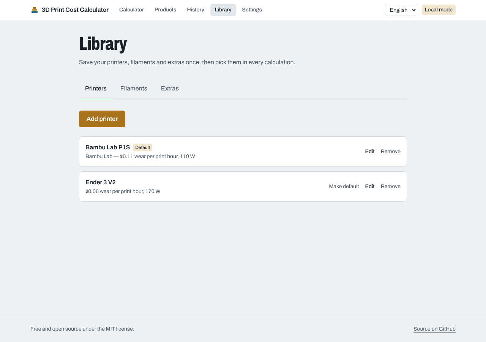
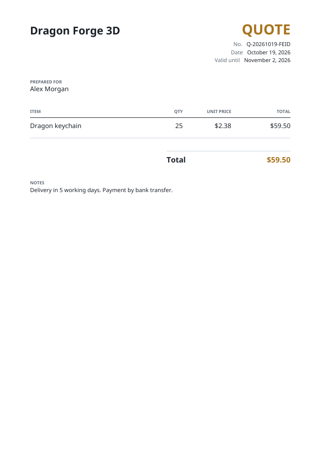
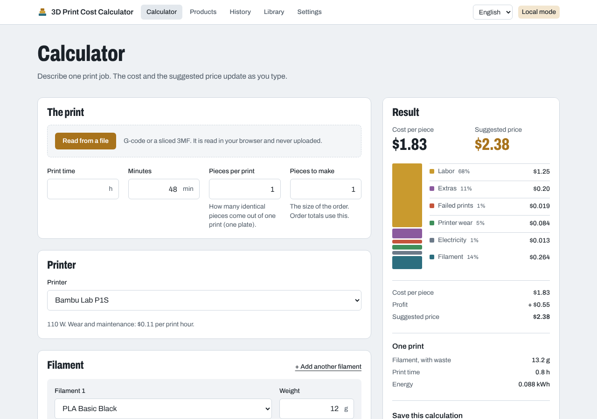

# 3D Print Cost Calculator

Work out what a 3D print **really** costs — not just the filament.

A free, open-source, self-hostable web app that adds up every part of a print:

- **Filament** by the gram, with waste from purges and supports (multi-material supported)
- **Electricity** from your printer's power draw and your kWh price
- **Printer wear**: depreciation over the printer's lifetime plus maintenance per print hour
- **Extras**: your own list of keyrings, magnets, heat-set inserts, glue, paint, packaging…
- **Labor**: preparation and post-processing time at your hourly rate
- **Business costs**: failure rate, overhead, profit margin, VAT and marketplace fees

…and turns it into a cost per piece and a suggested selling price. Available in English and Turkish.

## Features

- **Live calculator** with the cost shown as stacked layers, the price build-up (profit, VAT, marketplace fee), order totals and per-print figures.
- **Read your slicer's numbers**: drop a G-code file (PrusaSlicer, OrcaSlicer, Bambu Studio, Cura, Simplify3D) or a sliced Bambu/Orca 3MF and the print time and filament weight fill themselves in. Files are read in your browser and never uploaded.
- **Your own library** of printers, filaments and extras, with defaults and one-click reuse.
- **Products and history**: save calculations, group them under a product (with a photo), reopen them later and see how a price changes.
- **PDF quotes** for customers, with your business name. They never show your costs or profit.
- **Markup or margin**, VAT and marketplace fees, in TRY, USD or EUR.
- **Private by default**: guests get their own space without signing up; sign in with Google or GitHub to keep it across devices.

<p align="center">
  
  
</p>

The math is documented in [docs/cost-model.md](docs/cost-model.md).

<p align="center">
  
</p>

> **Status:** all planned features for the first release are in. It is young software: expect rough edges and please [open an issue](../../issues) when you hit one.

## Quick start

You need [Docker](https://docs.docker.com/get-docker/). Then:

```bash
git clone https://github.com/seniih/3d-print-cost-calculator.git
cd 3d-print-cost-calculator
docker compose up -d
```

Open <http://localhost:3000>. That's it — no configuration needed.

To update later: `git pull && docker compose up -d --build`.

## Local mode and public mode

The app picks its mode from the environment:

| Mode | When | Who can use it |
| --- | --- | --- |
| **Local** | No sign-in provider configured (the default) | Everyone on this instance shares one built-in user. Perfect for your own machine or home network. |
| **Public** | Google and/or GitHub sign-in configured | Visitors calculate as guests; their saved work moves to their account when they sign in. |

To run in public mode, copy `.env.example` to `.env`, set `BETTER_AUTH_URL` to your public address, generate a `BETTER_AUTH_SECRET` (`openssl rand -base64 32`) and add at least one OAuth app. Then `docker compose up -d --build`.

Put it behind a reverse proxy with HTTPS (Caddy, Traefik, nginx) before exposing it to the internet.

## Development

Requirements: Node.js 22+, pnpm 10+ (`corepack enable`), Docker (for Postgres).

```bash
pnpm install
cp .env.example .env
pnpm db:up          # start Postgres in Docker on localhost:5432
pnpm db:migrate     # apply migrations
pnpm dev            # http://localhost:3000
```

Useful scripts:

| Script | What it does |
| --- | --- |
| `pnpm lint` / `pnpm typecheck` / `pnpm test` | Checks run in CI |
| `pnpm db:migrate` | Create and apply a migration after editing `prisma/schema.prisma` |
| `pnpm db:studio` | Browse the database |

## Tech stack

- [Next.js](https://nextjs.org) (App Router, Cache Components) + TypeScript
- [PostgreSQL](https://www.postgresql.org) + [Prisma](https://www.prisma.io)
- [Better Auth](https://www.better-auth.com) — Google, GitHub and guest sessions
- [next-intl](https://next-intl.dev) — English and Turkish
- [Tailwind CSS](https://tailwindcss.com)
- [pdf-lib](https://pdf-lib.js.org) for quotes, [fflate](https://github.com/101arrowz/fflate) for reading 3MF files
- Docker Compose for one-command self-hosting

## Roadmap

- [x] Project skeleton: database, auth, i18n, Docker
- [x] Cost engine with unit tests
- [x] Printer, filament and extras libraries, and default settings
- [x] Calculator screen with cost breakdown and suggested price
- [x] Read weight and print time from G-code / 3MF files
- [x] Products and calculation history
- [x] PDF quotes for customers

Ideas for later (not started): PrusaSlicer binary G-code (`.bgcode`), quotes with several items, CSV export of the history, more languages, an API.

## Contributing

Issues and pull requests are welcome. Please run `pnpm lint && pnpm typecheck && pnpm test` before opening a PR.

## License

[MIT](LICENSE) © Ahmet Senih Demirel
